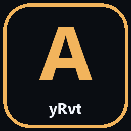
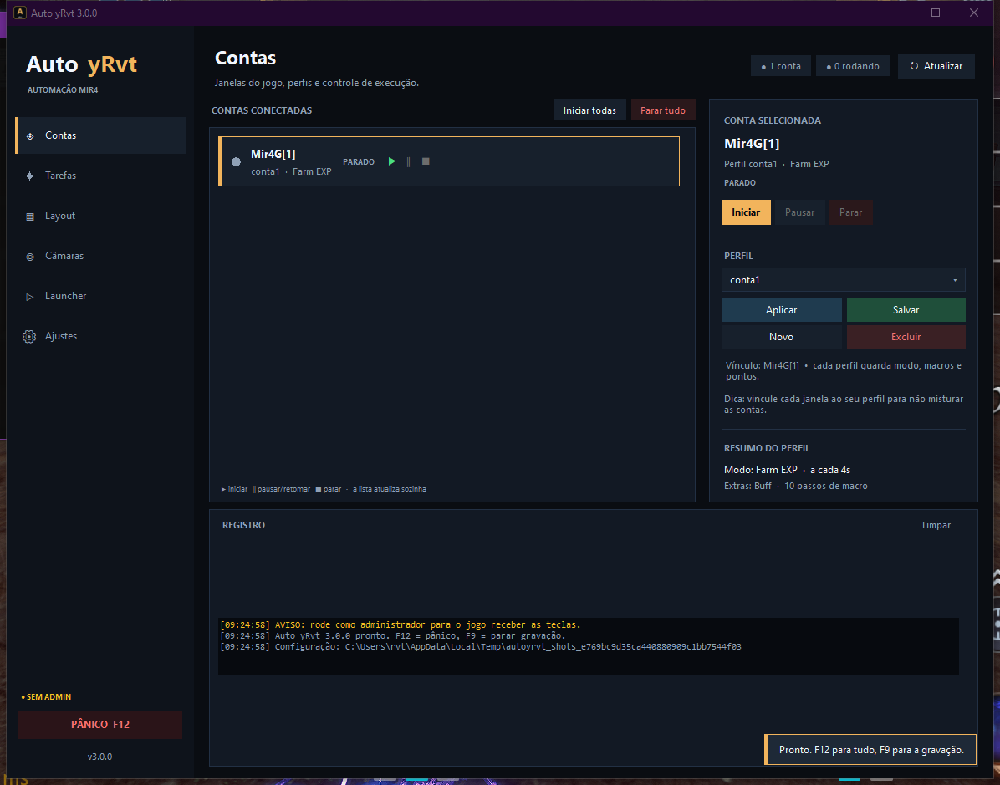
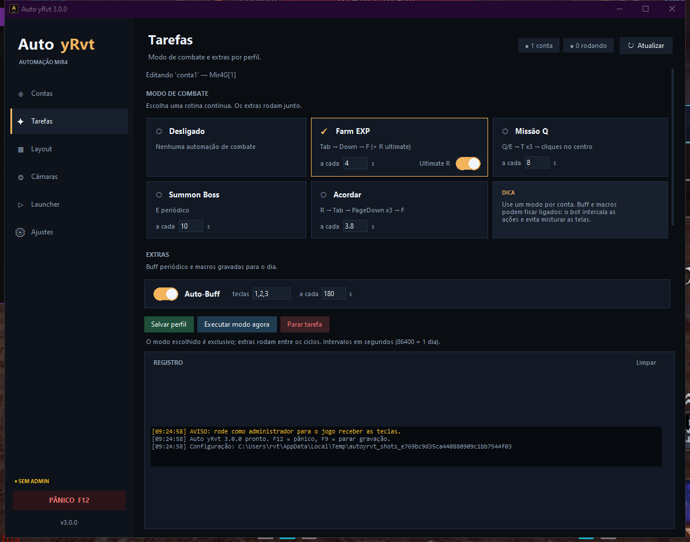
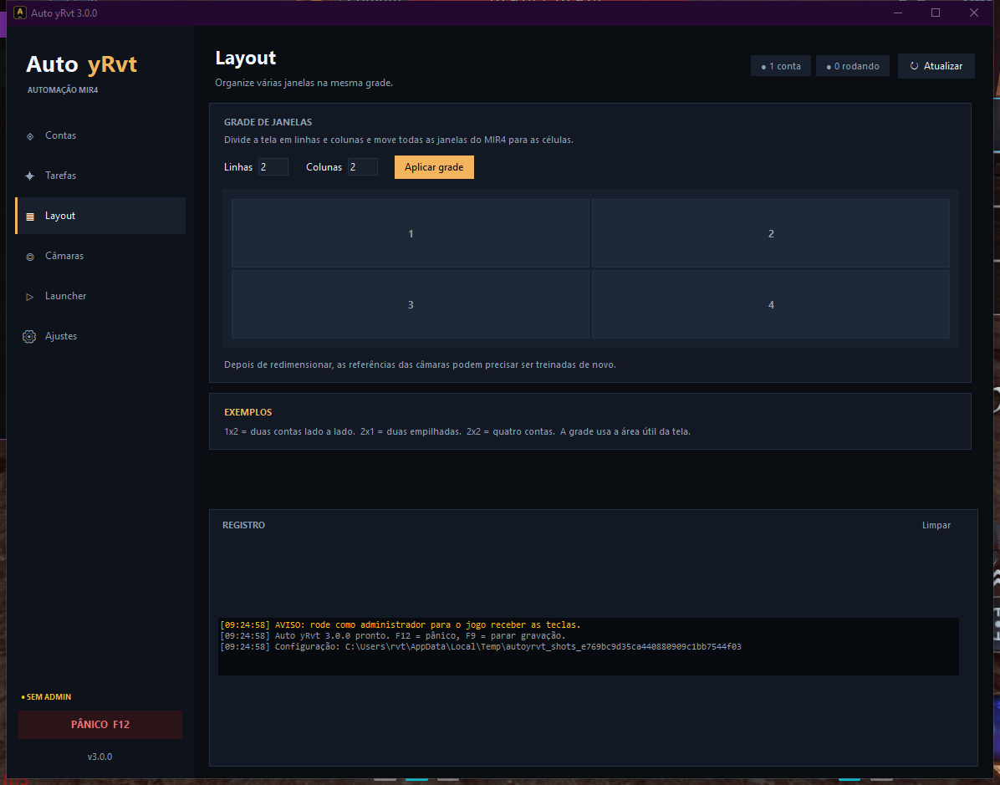
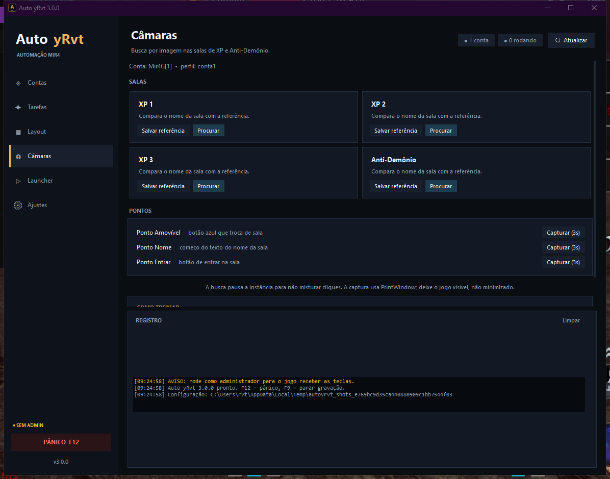

<div align="center">
  
  <h1>Auto yRvt</h1>
  <p><strong>Automação multi-conta para MIR4 no PC</strong><br>
  Interface moderna, perfis, macros graváveis e grade de janelas.</p>

  <p>
    
    
    
    <a href="../../releases"></a>
  </p>
</div>

> [!WARNING]
> A política do MIR4 proíbe automação de gameplay. Este projeto é para estudo
> e uso em conta descartável. Contas flagradas podem ser banidas. Não afiliado
> à Wemade/MIR4.

## Screenshots

| Contas | Tarefas |
| --- | --- |
|  |  |

| Layout | Câmaras |
| --- | --- |
|  |  |

## Por que Auto yRvt?

- **Multiconta de verdade**: uma instância por janela `Mir4G[...]`, com iniciar,
  pausar e parar individual.
- **Perfis por conta**: modo, intervalos, macros e pontos de câmara separados.
- **Macros graváveis**: doar clã e comprar Intensify sem coordenada fixa.
- **Interface agradável**: tema escuro, cards, toasts e animações leves.
- **Launcher PC**: abre Game 1/Game 2 com UIAutomation.
- **Câmaras por imagem**: XP 1, XP 2, XP 3 e Anti-Demônio.
- **Laboratório de XP**: mede %/hora e compara spots.

## Funcionalidades

- **Contas** em cards com status pulsando e ações rápidas.
- **Modos**: Farm EXP com Ultimate, Missão Q, Summon Boss e Acordar.
- **Extras**: Auto-Buff, Doar clã e Comprar Intensify.
- **Perfis** vinculados pelo título da janela.
- **Grade de janelas** com preview visual.
- **Busca de câmaras** por recorte de imagem.
- **Laboratório de XP** com sessões, %/hora, % por 10 min e gráfico.
- **Launcher / UIAutomation** com fallback para PostMessage.
- **Pânico F12** e parada de tudo.
- **Auto-update** via GitHub Releases.
- Migração automática da configuração antiga do MIR4 Bot.

## Instalação

Requisitos: Windows 10/11, Python 3.10+ e o jogo aberto.

```bat
git clone https://github.com/yRvtt/auto-yrvt.git
cd auto-yrvt
pip install -r requirements.txt
python run.py
```

Ou baixe o `AutoYrvt.exe` na aba [Releases](../../releases).
O exe pede administrador — necessário para o Windows entregar as mensagens à
janela do jogo.

## Uso rápido

1. Abra o MIR4 (uma ou mais janelas).
2. Abra o Auto yRvt e clique em **Atualizar**.
3. Selecione a conta na lista.
4. Crie/aplique um **perfil** (ex.: `conta1`) para vincular aquele título.
5. Escolha o **modo** e ajuste o intervalo.
6. Clique em **Salvar** e depois em **Iniciar** (ou **Iniciar todas**).

A navegação fica na barra lateral: **Contas**, **Tarefas**, **Layout**, **XP**,
**Câmaras**, **Launcher** e **Ajustes**. O registro fica no rodapé.

## Modos

| Modo | Sequência | Intervalo padrão |
| --- | --- | --- |
| Farm EXP | `Tab` → `Down` → `F` (+ `R` com Ultimate) | 4 s |
| Missão Q | `Q`/`E` → `T` x3 → 5 cliques no centro | 8 s |
| Summon Boss | `E` | 10 s |
| Acordar | `R` → menu → `Tab` → `PageDown` x3 → `F` | 3,8 s |

O modo é exclusivo. Buff e macros rodam entre os ciclos.

## Macros: doar clã e Intensify

As coordenadas mudam com resolução, cliente e layout. Por isso as macros são
**gravadas uma vez por perfil**:

1. Selecione a conta e abra a tela inicial do fluxo no jogo.
2. **Tarefas → Gravar** na linha **Doar clã** ou **Comprar Intensify**.
3. Espere os 3 s.
4. Faça a ação normalmente.
5. Pressione **F9** para parar.

A macro guarda cliques em coordenadas relativas e tempos; o campo **repetir**
executa várias vezes (Intensify já vem com 4). Use **Testar** com a conta parada.

## Multiconta, perfis e grade

- **Atualizar** lista todas as janelas `Mir4G`.
- Selecione uma conta, escolha o perfil e clique em **Aplicar**. O vínculo é
  salvo pelo título (`Mir4G[0]`, `Mir4G[1]`, ...).
- **Novo** cria um perfil; **Excluir** remove (o `default` é protegido).
- **Iniciar todas** sobe o modo/extras de cada conta.
- **Layout** aplica uma grade `linhas x colunas` em todas as janelas.

Para evitar duas contas dividindo o mesmo perfil, vincule cada janela ao seu
próprio perfil.

## Laboratório de XP

Serve para descobrir qual spot rende mais XP no mesmo tempo:

1. Abra a página **XP**.
2. Digite o nome do spot e o **XP inicial (%)** que aparece no jogo.
3. Clique em **Iniciar sessão** e deixe o macro rodando no spot.
4. Ao voltar, informe o **XP final (%)** e clique em **Finalizar e calcular**.
5. Repita em outro spot.

O app calcula **%/hora**, **% em 10 minutos**, guarda o histórico e mostra um
gráfico comparando os spots. Se o XP final for menor, ele pergunta quantos
níveis subiram e soma 100% por nível.

Hoje o XP é informado manualmente. A leitura automática por OCR está no roadmap.

## Launcher PC / UIAutomation

1. Informe o caminho do launcher (ou uma URL `steam://...`).
2. Informe parte do título da janela do launcher (padrão `MIR4`).
3. Capture as coordenadas de **Game 1** e **Game 2**.
4. Clique em **Abrir 2 clientes (UIA)**.

Com `pywinauto`, o bot tenta invocar os botões por UIAutomation; se não achar,
cai para clique via `PostMessage`.

## Câmaras

1. Abra a tela das câmaras no jogo.
2. Capture **Ponto Amovível**, **Ponto Nome** e **Ponto Entrar**.
3. Salve a referência de cada sala enquanto ela aparece.
4. Use **Procurar**. A busca pausa a conta para não misturar cliques.

A captura usa `PrintWindow`; o jogo pode ficar atrás de outras janelas, mas não
minimizado.

## Configuração e migração

Tudo fica em:

```text
%APPDATA%\AutoYrvt\state.json
```

Na primeira execução, o Auto yRvt copia `%APPDATA%\MIR4Bot\state.json` se
existir; senão importa os pontos/referências de `%APPDATA%\MIR4Bot\salas.json`.
O arquivo antigo não é apagado.

Para usar outra pasta (testes/portátil):

```bat
set AUTO_YRVT_CONFIG_DIR=C:\caminho\config
python run.py
```

## Estrutura

```text
auto_yrvt/
  __main__.py       entrada e DPI
  core.py           janelas, teclas, captura, perfis, macros, instâncias
  ui.py             interface Tkinter e animações
  updater.py        auto-update GitHub
  resources/        ícone
tests/              testes do núcleo
docs/               arquitetura e screenshots
run.py              atalho de execução
build.bat           gera dist\AutoYrvt.exe
```

Detalhes de arquitetura em [docs/ARCHITECTURE.md](docs/ARCHITECTURE.md).

## Desenvolvimento

```bat
python run.py
python -m unittest discover -s tests -v
build.bat
```

O build gera `dist\AutoYrvt.exe` com PyInstaller onefile, ícone e UAC admin.
O workflow de release compila em tags `v*` e anexa o exe.

## Roadmap

- [ ] Presets de macro por resolução.
- [ ] OCR para nomes de sala sem imagem de referência.
- [ ] Leitura automática do XP (OCR ou barra) para sessões sem digitação.
- [ ] Mais modos de farm e prioridade por conta.
- [ ] Exportar/importar perfis.
- [ ] Temas claros/escuros.

Tem uma ideia? Abra uma issue.

## Contribuindo

Leia [CONTRIBUTING.md](CONTRIBUTING.md). PRs pequenos, com teste e descrição do
que foi validado no jogo, são muito bem-vindos.

## Licença

MIT — veja [LICENSE](LICENSE).

---

<div align="center">
  <sub>Feito por <a href="https://github.com/yRvtt">yRvtt</a>.
  Se o projeto te ajudar, deixa uma ⭐ — isso ajuda o repositório a aparecer.</sub>
</div>
